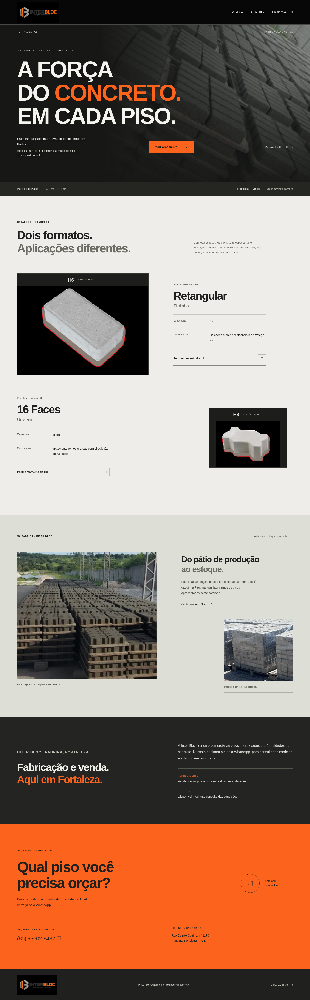

# Inter Bloc

Site institucional com Next.js (App Router), TypeScript e Tailwind CSS. Design aprovado pela empresa, com logotipo e fotografias oficiais. O catálogo apresenta H6 Retangular (6 cm) e H8 16 Faces (8 cm). O orçamento abre o WhatsApp oficial. A empresa não realiza instalação; entrega mediante consulta. Não há formulário; a configuração de publicação na Vercel está em `vercel.json`.

## Ambiente

- Node.js 24 (versão indicada em `.nvmrc`) e npm.
- Nenhuma chave, banco de dados ou variável de ambiente é necessária nesta etapa.

```bash
npm ci
npm run dev -- --hostname 127.0.0.1
```

Em ambientes com diretório pessoal sem permissão de escrita, use `npm_config_cache=/tmp/interbloc-npm-cache` antes dos comandos npm.

## Verificações

```bash
npm run lint
npm run typecheck
npm run build
npm run start -- --hostname 127.0.0.1
```

O servidor usa a porta 3000. Para conferir a resposta local, execute `curl --fail http://127.0.0.1:3000` em outro terminal. Encerre o servidor de desenvolvimento antes de iniciar o de produção na mesma porta.

## Estrutura

- `src/app/page.tsx`: seções da página inicial.
- `src/app/layout.tsx`: idioma e metadados; indexação permitida para a versão pública.
- `src/app/globals.css`: Tailwind e estilos da identidade visual aprovada.
- `public/`: arquivos estáticos.

Não há fontes ou imagens externas necessárias para renderizar a página. Os links do menu levam às seções reais da página. As imagens são os arquivos oficiais em `public/images`: logotipo original no cabeçalho e rodapé; H6/H8 no catálogo; pisos empilhados no hero; pátio e estoque na seção de produção. Os 10 PNG originais permanecem intactos. Next/Image gera versões otimizadas localmente. O H8 original tem 300 × 300 pixels; por isso a imagem do produto tem tamanho de exibição limitado. Animações respeitam a preferência por movimento reduzido.

A publicação foi autorizada após a aprovação do design. A branch `main` contém a versão de produção; `feat/interbloc-site` preserva o histórico do desenvolvimento. `npm run build` gera apenas os arquivos locais de produção; a integração Git da Vercel executa a implantação após o envio à branch de produção configurada no projeto.

## Capturas para revisão do design

As capturas da versão atual estão salvas no próprio repositório e podem ser abertas no GitHub sem publicar o site:

- [Desktop — 1440 px](docs/previews/desktop.png)
- [Mobile — 390 px](docs/previews/mobile.png)




## Refinamento editorial e movimento

A segunda etapa preserva a estrutura do site, os produtos e as fotografias oficiais. O hero tem uma sequência de entrada para foto, identificação, título, descrição e orçamento. Os títulos das seções, imagens, informações dos produtos e contato recebem revelações discretas por rolagem.

- `src/components/scroll-reveals.tsx`: um único Intersection Observer observa os elementos `data-reveal`, anima cada um uma vez e deixa de observá-lo. Não há biblioteca de animação nem listener contínuo de scroll.
- `src/app/globals.css`: keyframes, atrasos, hover, feedback de toque e regras responsivas. `prefers-reduced-motion` desativa as animações, inclusive se a preferência mudar durante a navegação.
- O conteúdo é visível no HTML inicial; a animação é aplicada somente ao entrar na tela. Sem JavaScript ou sem Intersection Observer, textos, imagens e links continuam disponíveis.
- O catálogo mantém as fotos originais: H6 recebe um enquadramento mais próximo; H8 fica limitado a 300 px e não recebe zoom no hover. Não há reconstrução, recoloração ou ampliação artificial dos arquivos.

As capturas em `docs/previews/` correspondem ao refinamento atual. Consulte [a validação da etapa](docs/refinement-validation.md) para o escopo dos testes.

## Nova revisão editorial — aguardando aprovação

A branch `feat/editorial-refinement` contém uma proposta de refinamento dos textos, hierarquia e composição das seções, sem alterar o título principal, o logotipo ou as fotografias oficiais. Ela não foi incorporada à produção. Consulte [o resumo e a validação desta revisão](docs/editorial-review.md). As capturas `docs/previews/desktop.png` e `mobile.png` nesta branch mostram a nova proposta.
